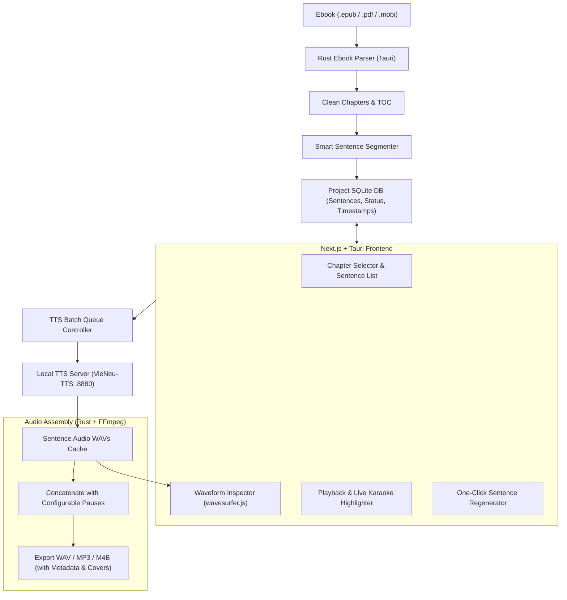

# Project Requirements Document (PRD) — BookStudio

## Project Overview

**Name:** BookStudio (Audiobook Production Studio)  
**Mission:** A high-performance, studio-grade desktop application for Windows & macOS that transforms eBooks (`.epub`, `.pdf`, `.mobi`) into professional multi-chapter audiobooks with sentence-level TTS synthesis, interactive waveform visualization, precision audio regeneration, and chapter-marked audio export.  
**Tech Stack:** Next.js (App Router, Static Export) / React 19 + TypeScript + Tailwind CSS + Tauri v2 (Rust Backend) + `wavesurfer.js` + SQLite + [[VieNeu-TTS]] OpenAI Speech Integration.

---

## Functional Requirements

| FR ID | Feature Description | User Story | Status |
| :--- | :--- | :--- | :--- |
| **FR-001** | **Ebook Ingestion & Metadata Extraction** | As an audiobook creator, I want to drag & drop EPUB, PDF, or MOBI files so that the app automatically extracts title, author, cover image, and the chapter structure (TOC). | **MUS** |
| **FR-002** | **Smart Sentence Segmentation & Text Normalization** | As an editor, I want book chapters to be automatically split into clean, granular sentences with smart punctuation handling (dialogue dashes `—`, quotes `""`, ellipses `...`) so that TTS reading sounds natural without sentence clipping. | **MUS** |
| **FR-003** | **TTS Engine Integration & Voice Preset Manager** | As a producer, I want to connect to a local TTS server ([[VieNeu-TTS]] via OpenAI Speech API) and choose voice presets (e.g. `Thảo Nhi`, `Ngọc Lan 18`, etc.) with speed and temperature sliders so that I have complete control over reading style. | **MUS** |
| **FR-004** | **Sentence-Level Waveform Inspector & Synchronized Playback** | As an audio editor, I want to see an interactive waveform for each synthesized sentence with teleprompter-style sentence highlighting as audio plays so that I can immediately detect audio defects or mispronunciations. | **MUS** |
| **FR-005** | **One-Click Sentence Audio Regeneration & Text Edit** | As an editor, I want to edit text or adjust temperature and click "Regenerate" on any individual misread sentence so that I don't have to re-synthesize the entire 15-minute chapter when only one word was mispronounced. | **MUS** |
| **FR-006** | **Chapter Assembly & Multi-Format Audio Export** | As a creator, I want to assemble all sentence audio files with natural inter-sentence pauses (configurable ms) and export the entire book/chapter into WAV (Master), MP3 (with ID3 tags & cover), and M4B (with chapter markers). | **MUS** |
| **FR-007** | **Project State Persistence & Local SQLite Cache** | As a user, I want my projects, parsed chapters, audio caches, and editing history to be auto-saved locally so that I can close the app and resume producing my audiobook anytime without losing progress. | **MUS** |
| **FR-008** | **Multi-Voice & Character Dialogue Assignment** | As a storyteller, I want to assign distinct voices to narration vs character dialogue lines so that the audiobook sounds like a multi-cast drama. | **Future** |
| **FR-009** | **Background Music (BGM) & Ambient Sound Effects** | As an audio designer, I want to add subtle background music and atmospheric sound effects under narration tracks with automatic audio ducking. | **Future** |
| **FR-010** | **Embedded Offline Piper/Sherpa-ONNX Engine** | As an offline user, I want the option to synthesize audio directly inside the desktop app using lightweight ONNX models without needing an external Python server. | **Future** |

---

## Technical Architecture & Workflow Pipeline

