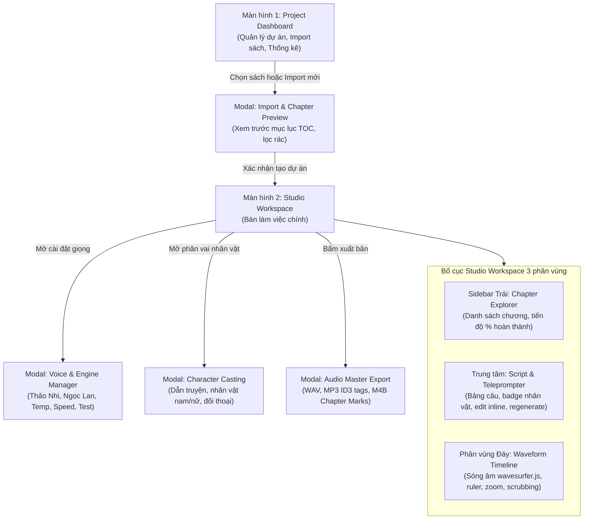

# 🎨 BookStudio — UI/UX Design System & Screen Mockups

> Tài liệu đặc tả hệ thống giao diện trực quan và phân tích tham chiếu các phần mềm Audio Studio hàng đầu thế giới dành cho dự án **BookStudio** (`D:\Workspace\Rust-Typescript\book-studio`).

---

## 1. Nghiên Cứu & Tham Chiếu Các Phần Mềm Audio Studio Thực Tế

Để BookStudio đạt chuẩn phòng thu chuyên nghiệp nhưng vẫn giữ được sự đơn giản, trực quan, chúng ta chắt lọc những tinh hoa từ các ứng dụng hàng đầu:

| Ứng dụng | Điểm mạnh cốt lõi được chắt lọc | Ứng dụng vào BookStudio |
| :--- | :--- | :--- |
| **ElevenLabs Projects** | Quản lý dự án dạng sách (EPUB/PDF), tự động chia chương, phân bổ giọng đọc theo đoạn, thanh tiến trình tạo âm thanh batch. | Áp dụng vào **Project Dashboard** & **TTS Batch Queue** theo từng chương. |
| **Descript** | Biên tập âm thanh dựa trên văn bản (Text-based audio editing): bấm vào chữ nào âm thanh nhảy tới đó, sửa chữ tự đồng bộ âm thanh. | Áp dụng vào **Teleprompter Karaoke Sync** & **Inline Sentence Editor**. |
| **Audacity / Hindenburg Pro** | Timeline đo thời gian chuẩn xác, xem biên độ sóng âm (Peak / RMS), tùy chỉnh khoảng lặng nối câu (Pause injection), chuẩn âm lượng ACX / EBU R128. | Áp dụng vào **WaveSurfer Timeline** & **Bộ ghép nối Audio Engine (Rust + Hound)**. |
| **CapCut / Linear UI** | Ngôn ngữ thiết kế Dark Mode tối giản, hiện đại (Slate/Zinc, điểm nhấn Neon Indigo/Purple), các phím tắt nhanh (`Space` Play/Pause, `Ctrl+Enter` Regenerate). | Áp dụng vào toàn bộ hệ thống giao diện **Tailwind + shadcn/ui**. |

---

## 2. Bản Đồ Màn Hình & Luồng Trải Nghiệm Người Dùng (Screen Flow)

---

## 3. Danh Mục Các Màn Hình & Modal Đã Thiết Kế

1. **[01_screen_dashboard.md](file:///D:/Workspace/Rust-Typescript/book-studio/mockups/01_screen_dashboard.md)**: Màn hình Dashboard quản lý sách, thẻ dự án, thanh tìm kiếm, thống kê thời lượng audio và khu vực kéo thả (Dropzone).
2. **[02_screen_studio.md](file:///D:/Workspace/Rust-Typescript/book-studio/mockups/02_screen_studio.md)**: Màn hình Studio Workspace - Trái tim của ứng dụng với bố cục 3 phân vùng tương tác thời gian thực.
3. **[03_modals_and_overlays.md](file:///D:/Workspace/Rust-Typescript/book-studio/mockups/03_modals_and_overlays.md)**: Hệ thống 5 Modal cốt lõi (Export Audio, Voice Manager, Character Casting, Import Preview, Settings).
4. **[studio_interactive_prototype.html](file:///D:/Workspace/Rust-Typescript/book-studio/mockups/studio_interactive_prototype.html)**: ⭐️ **Bản Prototype HTML/Tailwind hoàn chỉnh**: Anh có thể mở trực tiếp bằng trình duyệt để bấm thử các tab, xem sóng âm thật trên Canvas, mở các modal và trải nghiệm trực quan 100%.

---

## 4. Bảng Màu & Design Tokens Chuẩn Studio

- **Background Base:** `#09090b` (Deep Dark Zinc) — Chống mỏi mắt khi làm việc ban đêm.
- **Surface / Card:** `#18181b` (Zinc 900) với border `#27272a` (Zinc 800).
- **Brand Accent:** `#6366f1` (Indigo 500) $\rightarrow$ `#a855f7` (Purple 500) Gradient.
- **Waveform Colors:**
  - Sóng chưa phát: `#4f46e5` (Deep Indigo).
  - Sóng đã phát qua: `#ec4899` (Vivid Pink / Purple).
  - Con trỏ phát (Playhead): `#f43f5e` (Rose Neon 500).
- **Status Badges:**
  - `Ready / Synced`: `#10b981` (Emerald green).
  - `Generating`: `#f59e0b` (Amber - có hiệu ứng pulse).
  - `Pending / Unread`: `#71717a` (Zinc muted).
  - `Error / Clipping`: `#ef4444` (Ruby red).
